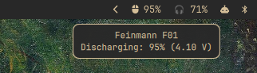

# pulsar-battery-widget

Shows the battery level of a Pulsar wireless gaming mouse connected
through the Pulsar LINK 2 dongle, either as an
[Omarchy](https://omarchy.org/) bar widget or as a
[Waybar](https://github.com/Alexays/Waybar) custom module.



Tested with the **Pulsar Feinmann F01** and the LINK 2 dongle
(`3710:5504`). Other Pulsar mice paired to the same dongle will most
likely work too, since the module only talks to the dongle.

Both frontends run the same script, `pulsar-battery.py`, which queries the
dongle over hidraw and prints Waybar-style JSON.

## Requirements

- Python 3 (standard library only)
- A [Nerd Font](https://www.nerdfonts.com/) for the mouse/bolt glyphs
  (Omarchy ships one)
- Read/write access to the dongle's hidraw node (see below)

## Permissions

On most distributions hidraw nodes are root-only. Install the bundled
udev rule to grant access to the locally logged-in user. This is the only
step that needs root, and the plugin never runs anything privileged itself:

```sh
sudo cp 99-pulsar-link2.rules /etc/udev/rules.d/
sudo udevadm control --reload && sudo udevadm trigger
```

Then re-plug the dongle. The rule only tags the LINK 2 dongle
(`3710:5504`) with `uaccess`; to undo it, delete
`/etc/udev/rules.d/99-pulsar-link2.rules` and reload udev the same way.

## Omarchy bar widget

The repository root is an Omarchy bar-widget plugin
(`io.github.michalgritzbach.pulsar-battery`):

```sh
omarchy plugin add https://github.com/michalgritzbach/pulsar-battery-widget.git --enable
```

Install the udev rule from the checkout it creates:

```sh
cd ~/.config/omarchy/plugins/io.github.michalgritzbach.pulsar-battery
sudo cp 99-pulsar-link2.rules /etc/udev/rules.d/
sudo udevadm control --reload && sudo udevadm trigger
```

You can verify the script with `./pulsar-battery.py`, which should print a
JSON line with the current battery level.

The widget shows `󰍽 87%`, adds a bolt while charging, turns the bar's urgent
color at 20% or below or when the mouse is not connected, and hides itself
when the dongle is unplugged. The tooltip shows the charge state and cell
voltage. Left click refreshes immediately.

Per-widget settings go in the widget's `bar.layout` entry in
`~/.config/omarchy/shell.json`:

| Key | Default | Meaning |
|---|---|---|
| `interval` | `60` | Seconds between polls |
| `command` | — | Script path or shell command to run instead of the bundled script |
| `chargingColor` | `#a6e3a1` | Text color while charging |
| `onClick` / `onRightClick` / `onMiddleClick` | — | Shell command per button; empty left click refreshes |
| `fontSize` | `12` | Label size |

Do **not** name a setting `exec` or `source`: the bar treats any layout entry
carrying those keys as a built-in command/QML module and never loads the plugin.

Update with `omarchy plugin update io.github.michalgritzbach.pulsar-battery`
and uninstall with `omarchy plugin remove io.github.michalgritzbach.pulsar-battery`.

### Developing

Symlink a checkout instead of cloning through `omarchy plugin add`:

```sh
ln -sfn "$PWD" ~/.config/omarchy/plugins/io.github.michalgritzbach.pulsar-battery
omarchy plugin validate .
omarchy restart shell
```

## Waybar module

```sh
mkdir -p ~/.config/waybar/scripts
cp pulsar-battery.py ~/.config/waybar/scripts/
chmod +x ~/.config/waybar/scripts/pulsar-battery.py
```

Install the udev rule (see [Permissions](#permissions)), then add the module
to `~/.config/waybar/config.jsonc`:

```jsonc
"modules-right": [ /* ... */ "custom/pulsar-battery" /* ... */ ],

"custom/pulsar-battery": {
  "exec": "~/.config/waybar/scripts/pulsar-battery.py",
  "interval": 60,
  "return-type": "json",
  "format": "{}",
  "tooltip": true
}
```

And the colors to `~/.config/waybar/style.css`:

```css
#custom-pulsar-battery.charging {
  color: #a6e3a1;
}

#custom-pulsar-battery.critical,
#custom-pulsar-battery.disconnected {
  color: #f38ba8;
}
```

Restart Waybar. The tooltip shows the charge state and cell voltage;
the module hides itself entirely when the dongle is unplugged.

## Notes

- If Pulsar's [Bibimbap](https://support.pulsar.gg/hc/en-us/articles/58653339537177-How-can-I-use-the-web-driver-Bibimbap)
  web driver is open in a browser tab at the same time, it may
  occasionally consume a response; the script retries up to three times,
  but closing the tab helps if you see `󰍽 ?`.
- Polling once a minute has no measurable effect on the mouse's battery.

## Credits

The HID protocol details come from Nikolas Koesling's proposed
[`hid-pulsar` kernel driver](https://ratatoskr.run/linux-input/2026/04/3494264).

## License

[MIT](LICENSE)
